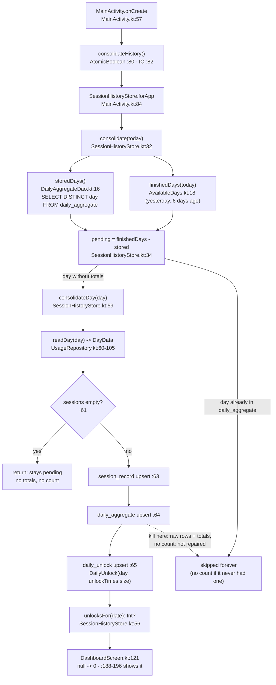

# Mechanism note — The stored daily unlock count (`daily_unlock`)

> Anchored by `/spec-explain` · 2026-10-19. This is documentation of the mechanism; the contract
> lives in `openspec/specs/usage-tracking/spec.md` and in the change deltas. Code is the authority —
> refs are `path:line` at the time of writing. The owning change is **`stored-day-unlocks`**
> (`change/stored-day-unlocks`, verified; `main` contains its implementation commit `92bde98`).
> The requirement for the stored count is still only in the change delta
> (`openspec/changes/stored-day-unlocks/specs/usage-tracking/spec.md:5-20`); it has not been merged
> into the living spec.

## Short answers

1. **Table and writer.** The count lives in `daily_unlock`, one row per consolidated day
   (`app/src/main/java/com/foco/app/data/db/DailyUnlock.kt:9-12`). The only function that writes a
   count for a day other than today is `SessionHistoryStore.consolidateDay`
   (`app/src/main/java/com/foco/app/data/SessionHistoryStore.kt:59-66`), reached from
   `SessionHistoryStore.consolidate` (`:32-37`). The old day never gets a count because
   `consolidate` treats "this day has rows in `daily_aggregate`" as "this day is already done":
   `stored = aggregates.storedDays().toSet()` (`:33`) and
   `pending = finishedDays(today).filterNot { it.toString() in stored }` (`:34`). A day consolidated
   by version 1 has totals, so it is in `stored` and never enters `pending`; `consolidateDay` never
   runs for it. The v1→v2 migration only creates an empty table
   (`app/src/main/java/com/foco/app/data/db/FocoDatabase.kt:27-34`), and there is no retro-fill by
   design (`openspec/changes/stored-day-unlocks/proposal.md:59-60`). `finishedDays` only covers
   yesterday through six days ago (`app/src/main/java/com/foco/app/domain/AvailableDays.kt:18-21`).
   The missing test is "does this day already have a count?" — the presence of totals is used as the
   completion marker for both totals and count.

2. **Killed between totals and count.** The three writes in `consolidateDay` are separate
   auto-commit transactions (there is no `@Transaction`, `withTransaction` or `runInTransaction`
   anywhere in `app/src`). A kill after `aggregates.upsert(...)` (`SessionHistoryStore.kt:64`) and
   before `unlocks.upsert(...)` (`:65`) leaves, for that day: N rows in `session_record` (one per
   session, written at `:63`), M rows in `daily_aggregate` (one per distinct package, written at
   `:64`), and **zero rows in `daily_unlock`**. The next start does **not** repair them:
   `SessionHistoryStore.consolidate` (`:32-37`) reads `DailyAggregateDao.storedDays()`
   (`app/src/main/java/com/foco/app/data/db/DailyAggregateDao.kt:16-17`), the day is in `stored`,
   `filterNot` removes it from `pending`, and `consolidateDay` is never called. The count stays
   `null`; the dated dashboard maps that to `0` (`app/src/main/java/com/foco/app/ui/dashboard/DashboardScreen.kt:121`).
   The function and table that decide are `SessionHistoryStore.consolidate` and `daily_aggregate`
   (through `DailyAggregateDao.storedDays`). The symmetric case *is* repaired: a kill before the
   totals leaves the day out of `stored`, so the next start retries it, and all three writes are
   idempotent because every DAO upsert is `REPLACE`
   (`SessionRecordDao.kt:12-13`, `DailyAggregateDao.kt:13-14`, `DailyUnlockDao.kt:12-13`). The
   comment at `SessionHistoryStore.kt:62` records this asymmetry: raw first, totals second, count
   last, because the count is the only write with no retry.

3. **One more number per day (schema v3).** The SQL of `MIGRATION_2_3` must produce exactly the
   table structure that Room exports in `app/schemas/com.foco.app.data.db.FocoDatabase/3.json`:
   same column names, affinities, `NOT NULL`, defaults, primary-key columns and order, indexes and
   foreign keys. `MigrationTestHelper.runMigrationsAndValidate` does not compare SQL text; it runs
   the migrations and compares `TableInfo.read` against the schema bundle
   (`UnlockMigrationTest.kt:34`; Room 2.8 `MigrationTestHelper.MigratingDelegate.onValidateSchema`).
   With `validateDroppedTables = true`, an extra table also fails. The `3.json` must exist as an
   androidTest asset (already wired by `app/build.gradle.kts:42-45`), be generated by KSP
   (`:48-51`) and be committed. The test must receive every migration needed to cover the jump
   (`MIGRATION_2_3`, or `MIGRATION_1_2` + `MIGRATION_2_3` if it starts at v1), because the helper
   builds a `MigrationContainer` only from the arguments and opens with `requireMigration = true`.
   A new `NOT NULL` column needs a `DEFAULT` in both the entity and the `ALTER TABLE`. Registering
   the migration in the real builder (`SessionHistoryStore.kt:91`) is a separate step the migration
   test does not cover.

## Mechanism, step by step

1. **Trigger: activity creation.** `MainActivity.onCreate` calls `consolidateHistory()`
   (`app/src/main/java/com/foco/app/MainActivity.kt:57`). That function guards with an
   `AtomicBoolean` (`:80`, field at `:98`), launches on `Dispatchers.IO` (`:82`), builds the store
   over the real database (`:84`) and calls `consolidate(LocalDate.now())` (`:85`). Any failure is
   logged and swallowed (`:86-93`). There is no WorkManager/periodic worker in `app/src`; startup is
   the only trigger.
2. **Which days are pending.** `SessionHistoryStore.consolidate(today)`
   (`app/src/main/java/com/foco/app/data/SessionHistoryStore.kt:32-37`) reads the days that already
   have totals and subtracts them from the finished-day window:

   ```kotlin
   val stored = aggregates.storedDays().toSet()                              // SessionHistoryStore.kt:33
   val pending = finishedDays(today).filterNot { it.toString() in stored }.sorted()  // :34
   ```

   It then runs `pending.forEach { consolidateDay(it) }` (`:35`) and prunes raw rows (`:36`).
   `storedDays()` is `SELECT DISTINCT day FROM daily_aggregate`
   (`app/src/main/java/com/foco/app/data/db/DailyAggregateDao.kt:16-17`).
3. **Backfill window.** `finishedDays` returns yesterday through six days ago, never today
   (`app/src/main/java/com/foco/app/domain/AvailableDays.kt:18-21`).
4. **The writer.** `SessionHistoryStore.consolidateDay` (`SessionHistoryStore.kt:59-66`) does one
   `readDay(day)` (`:60`), returns early when there are no sessions (`:61`), then writes raw sessions
   (`:63`), per-app totals (`:64`) and the count
   `unlocks.upsert(DailyUnlock(day.toString(), data.unlockTimes.size))` (`:65`).
5. **Where the number comes from.** `UsageRepository.loadDay` queries the platform
   (`app/src/main/java/com/foco/app/data/UsageRepository.kt:66`), collects only
   `KEYGUARD_HIDDEN` events of the requested day (`:76-78`), and returns them as
   `DayData.unlockTimes` (`:103`). The stored count is `size` of that same read; there is no second
   query and no new permission.
6. **Physical location.** Table `daily_unlock`, one row per consolidated day:
   `@Entity(tableName = "daily_unlock", primaryKeys = ["day"])` with `day: String` and `count: Int`
   (`app/src/main/java/com/foco/app/data/db/DailyUnlock.kt:9-12`). The upsert is
   `@Insert(onConflict = OnConflictStrategy.REPLACE)` (`DailyUnlockDao.kt:12-13`). The DAO has no
   delete (`DailyUnlockDao.kt:8`), so pruning cannot reach it.
7. **Read.** `SessionHistoryStore.unlocksFor(date)` (`SessionHistoryStore.kt:56`) runs
   `SELECT count FROM daily_unlock WHERE day = :day` with an `Int?` result
   (`DailyUnlockDao.kt:15-16`). The dated dashboard collapses absence to zero:
   `readOr(0) { store.unlocksFor(requestedDate) ?: 0 }` (`DashboardScreen.kt:121`), and shows it in
   the subtitle (`:188-196`).
8. **Why a version-1 day stays "no stored count".** `stored` comes only from `daily_aggregate`
   (`SessionHistoryStore.kt:33`) and the filter is `filterNot { it.toString() in stored }` (`:34`).
   A v1-consolidated day has totals, so it is skipped; `consolidateDay` never runs. `finishedDays`
   also stops at six days. There is no other writer of `daily_unlock` (the only `upsert` is `:65`),
   and the migration only creates an empty table (`FocoDatabase.kt:29-32`). This is deliberate: the
   proposal lists "no retro-fill" as a non-goal (`proposal.md:59-60`), and the device test pins the
   empty table after the upgrade (`app/src/androidTest/java/com/foco/app/data/db/UnlockMigrationTest.kt:38`).
9. **Why `null` vs `0` matters.** The query is nullable (`DailyUnlockDao.kt:16`): no row means
   "never stored", while a row with `count = 0` means "that day really had no unlocks". The
   distinction is declared in `SessionHistoryStore.kt:55` and in the delta
   (`.../stored-day-unlocks/specs/usage-tracking/spec.md:18-20`). The UI loses it by converting
   `null` to `0` (`DashboardScreen.kt:121`).

## Physical traceability

- **File**: `foco.db` in private storage (`DATABASE_NAME`, `SessionHistoryStore.kt:78`), opened once
  per process by `Room.databaseBuilder` with a `@Volatile` + `synchronized` double check
  (`SessionHistoryStore.kt:85-99`), registering `MIGRATION_1_2` at `:91`.
- **Tables**: `session_record` (raw), `daily_aggregate` (per-app/day totals) and `consolidated_day`
  (per-day marker carrying the unlock count) — all three pruned by the same cutoff.
- **Keys**: `consolidated_day` has PK `day`, an ISO text date from `LocalDate.toString()`
  (`SessionHistoryStore.kt:69`), the same format as `DailyAggregate`, so it sorts and compares
  as text.
- **Lifecycle**: the row is created during consolidation (`SessionHistoryStore.kt:69`), replaced if
  the day is consolidated again, and deleted with its day once the day leaves the retained days —
  today and the seven before it (`SessionHistoryStore.kt:37-40`). It grows one row per consolidated
  day, up to eight days.
- **Writers**: one, `consolidateDay` (`SessionHistoryStore.kt:59-66`), reached only from
  `consolidate` (`:32-37`), reached only from `MainActivity.kt:79-95`.
- **Readers**: `unlocksFor` (`SessionHistoryStore.kt:56`) from the dated dashboard
  (`DashboardScreen.kt:117-125`) and from the tests (`StoredUnlocksTest.kt:34,44,49,62,74`).
- **Nothing leaves the device**: no network and no new permission; `allowBackup="false"` stays in
  force (`openspec/specs/usage-tracking/spec.md:245-247`).

## Limits and failure modes

- **Process killed between totals and count (the requested case).** The three writes are separate
  Room transactions; there is no `withTransaction`, `@Transaction`, `runInTransaction` or
  `INSERT OR IGNORE` in `app/src`. A kill after `SessionHistoryStore.kt:64` and before `:65` leaves,
  for that day: N rows in `session_record` (`:63`), M rows in `daily_aggregate` (`:64`) and **zero
  rows in `daily_unlock`**. The next start reads `aggregates.storedDays()` (`:33`), the day is in
  `stored`, `filterNot` (`:34`) removes it from `pending`, and `consolidateDay` never runs: **no
  repair**. The decision is made by `SessionHistoryStore.consolidate` (`:32-37`) and the query
  `SELECT DISTINCT day FROM daily_aggregate` (`DailyAggregateDao.kt:16-17`). The repair window is
  `finishedDays` = yesterday…six days ago (`:34`, `AvailableDays.kt:18-21`), and only for days
  **without** totals; this case falls outside both conditions. `unlocksFor` answers `null` forever,
  and the UI shows `0` (`DashboardScreen.kt:121`).
- **The symmetric case is healed.** If the kill happens before the totals, the day is not in
  `stored`, remains in `pending`, and the next start retries it; all three writes are idempotent by
  `REPLACE` (`SessionRecordDao.kt:12-13`, `DailyAggregateDao.kt:13-14`, `DailyUnlockDao.kt:12-13`).
  The comment at `SessionHistoryStore.kt:62` documents that order; the count goes last because it is
  the only write with no retry.
- **A day with no sessions stores nothing.** The early return (`SessionHistoryStore.kt:61`) happens
  when `sessions` is empty, even if `unlockTimes` has values; the count is discarded. The day stays
  pending and is retried, but a day with unlocks and no app usage never gets a count. No requirement
  covers this.
- **Write failure**: it propagates to `MainActivity.kt:86-93`, is logged as
  "History backfill failed", and the app continues; days not reached remain pending.
- **Force close**: what SQLite committed stays; there is no state in memory beyond the
  `AtomicBoolean` (`MainActivity.kt:80,98`) and the `@Volatile` singleton
  (`SessionHistoryStore.kt:81-82`).
- **Data cleared / uninstall**: `foco.db` disappears; the next start creates the file at v2 (the
  migration does not run) and consolidates only the days the platform still serves.
- **Concurrency**: the writer runs on IO at startup (`MainActivity.kt:82`) while screens read the
  same file (`DashboardScreen.kt:83`, `AppDetailScreen.kt:68`, `WeekScreen.kt:77`). Room serializes;
  the row is unique per day, so a concurrent read sees the count or its absence, never a duplicate.
  A migration that does not match the entity fails when the file is opened (there is no
  `fallbackToDestructiveMigration`).
- **No network**: a missing count is an absent row in a local table; there is no server or sync.

## Touched APIs

- **`androidx.room.Entity`** (`DailyUnlock.kt:9`): declares the table and its primary key; a
  day primary key prevents two rows for the same day.
- **`@Dao` + `@Insert(onConflict = REPLACE)` + `@Query`** (`DailyUnlockDao.kt:9-16`): `REPLACE`
  turns a re-consolidation into an overwrite; the `@Query` returning `Int?` is what separates
  "not stored" from zero.
- **`RoomDatabase` / `@Database` + `addMigrations`** (`FocoDatabase.kt:12-23`,
  `SessionHistoryStore.kt:91`): the declared version makes Room look for the migration instead of
  rejecting the file; without registering it, a v1 `foco.db` would not open.
- **`androidx.room.migration.Migration` + `SupportSQLiteDatabase.execSQL`**
  (`FocoDatabase.kt:27-34`): the only door for raw DDL during the upgrade; it runs the
  `CREATE TABLE` that Room then validates against the exported schema.
- **`UsageStatsManager.queryEvents`** (`UsageRepository.kt:66`) and
  **`UsageEvents.Event.KEYGUARD_HIDDEN`** (`UsageRepository.kt:76-78`): the timestamps whose `size`
  is persisted.
- **`androidx.room.testing.MigrationTestHelper`** (`UnlockMigrationTest.kt:16-20,24,34`): creates a
  real file at an old version, runs the migrations and validates the resulting shape.

## Data flow



## Coverage in the living spec

| Part of the mechanism | Requirement |
|---|---|
| Consolidation stores the day so it outlives platform retention | **Yes** — "The day's data outlives the platform's retention" (`openspec/specs/usage-tracking/spec.md:212-231`), including "a day without totals stays pending" (`:229-231`) |
| Pruning does not delete totals | **Yes** — "The stored history is bounded" (`spec.md:233-243`) |
| The per-day count is stored with the totals, read as `null`/number and survives pruning | **Only in the delta** — `openspec/changes/stored-day-unlocks/specs/usage-tracking/spec.md:5-20` (change verified, not archived) |
| v1→v2 upgrade keeps what was stored and the day reads "not stored" | **Only in the delta** — same file `:18-20`; test is `UnlockMigrationTest.kt:22-40` |
| Pruning cannot reach `daily_unlock` | **Not covered** by any requirement; it holds by absence of delete (`DailyUnlockDao.kt:8`) |
| Showing a past day's count (and what to do with `null`) | **Not covered**: `DashboardScreen.kt:121` decides `null -> 0`; the `week-screen` delta does not add a requirement about the count |
| Stored count after a kill between totals and count (not repaired) | **Not covered**; no requirement or decision mentions it |
| Nightly job that consolidates without opening the app | **Draft delta only** — `openspec/changes/nightly-consolidation/specs/usage-tracking/spec.md:5-43`; no worker code |
| Migration mandatory and no destructive fallback | **Draft delta only** — `openspec/changes/schema-drift-guard/specs/usage-tracking/spec.md:22-32` |

## Adding one more number per day (schema v3)

Today: `version = 2` (`FocoDatabase.kt:14`), entities `session_record`, `daily_aggregate`,
`daily_unlock` (`FocoDatabase.kt:13`), accessors (`:19-23`), and one migration `MIGRATION_1_2`
(`:27-34`) registered in the builder (`SessionHistoryStore.kt:91`).

### Files that change

**If the new number is another column on `daily_unlock`** (the smallest change; the row is already
one per day):

1. `app/src/main/java/com/foco/app/data/db/DailyUnlock.kt` — add the field. If it is `NOT NULL`,
   declare `@ColumnInfo(defaultValue = "0")` (or the real default) so the exported schema and the
   `ALTER TABLE` agree.
2. `app/src/main/java/com/foco/app/data/db/FocoDatabase.kt` — bump `version = 3` and add
   `MIGRATION_2_3` with `ALTER TABLE daily_unlock ADD COLUMN ...`.
3. `app/schemas/com.foco.app.data.db.FocoDatabase/3.json` — generated by KSP (with
   `room.schemaLocation`, `app/build.gradle.kts:48-51`) and committed.
4. `app/src/main/java/com/foco/app/data/SessionHistoryStore.kt` — write the new value in
   `consolidateDay` (`:65`) and register the migration:
   `.addMigrations(FocoDatabase.MIGRATION_1_2, FocoDatabase.MIGRATION_2_3)` (`:91`). The `REPLACE`
   upsert writes the whole row, so every field must be supplied there.
5. `app/src/test/java/com/foco/app/data/HistoryFakes.kt` — update `FakeDailyUnlockDao`
   (`:56-65`) if the constructor/DAO changes; the store tests that build it
   (`StoredUnlocksTest.kt:24-25`, `HistoryConsolidationTest.kt:23-24`, `HistoryRetentionTest.kt:21`,
   `HistoryWeekTest.kt:14-19`) must compile.
6. `app/src/androidTest/java/com/foco/app/data/db/UnlockMigrationTest.kt` — add a v2→v3 test (see
   below).
7. `app/src/androidTest/java/com/foco/app/data/db/FocoDatabaseTest.kt` — optional, only if the new
   column's SQL behavior needs a device test (`FocoDatabaseTest.kt:35-70` is the mold).
8. Spec: a new change with its delta (`ADDED Requirement` + `[@test]`); the living spec changes only
   on archive. `BOARD.md` and `openspec/evidence.json` are regenerated by the gate, never by hand.

**If the new number is a new table** (independent fact, own lifecycle):

1. `app/src/main/java/com/foco/app/data/db/<Name>.kt` — new `@Entity` (one type per file).
2. `app/src/main/java/com/foco/app/data/db/<Name>Dao.kt` — `@Insert(REPLACE)` + `@Query`.
3. `app/src/main/java/com/foco/app/data/db/FocoDatabase.kt` — `version = 3`, add the entity,
   the accessor and `MIGRATION_2_3` with `CREATE TABLE`.
4. `app/src/main/java/com/foco/app/data/SessionHistoryStore.kt` — constructor parameter, `forApp`
   wiring, write in `consolidateDay`, and `addMigrations(..., MIGRATION_2_3)` (`:91`).
5. `app/schemas/.../3.json` — generated and committed.
6. `UnlockMigrationTest.kt`, `HistoryFakes.kt`, the JVM tests, and the spec delta, as above.

**If the new number comes from a new platform signal**, also change
`app/src/main/java/com/foco/app/model/day/DayData.kt` and
`app/src/main/java/com/foco/app/data/UsageRepository.kt:60-105` (the `loadDay` fold). If it is
derived from the existing `DayData` (for example `sessions.size`), the storage path is enough.

### What the new migration SQL must match

`MigrationTestHelper.runMigrationsAndValidate` runs the migrations and then validates the resulting
database against the schema bundle of the **target version**. It does not compare the SQL text; it
compares `TableInfo` per table, built from the exported JSON. The current call is

```kotlin
val migrated = helper.runMigrationsAndValidate(DB_NAME, 2, true, FocoDatabase.MIGRATION_1_2)
```

`app/src/androidTest/java/com/foco/app/data/db/UnlockMigrationTest.kt:34`, validating the table
created by

```kotlin
db.execSQL(
    "CREATE TABLE IF NOT EXISTS `daily_unlock` (`day` TEXT NOT NULL, " +
        "`count` INTEGER NOT NULL, PRIMARY KEY(`day`))"
)
```

`app/src/main/java/com/foco/app/data/db/FocoDatabase.kt:29-32`, which is identical to the
`createSql` exported in `app/schemas/com.foco.app.data.db.FocoDatabase/2.json:82`.

Exact conditions for v3:

- **The target JSON must exist as an androidTest asset.** The helper derives the folder from the
  canonical class name (`assetsFolder` = `com.foco.app.data.db.FocoDatabase`) and opens
  `$assetsFolder/3.json`; if it is missing, it throws `FileNotFoundException`. `app/build.gradle.kts:42-45`
  already adds `app/schemas/` as androidTest assets, so you need a new `3.json` (and keep `2.json`
  to create a v2 file). Do not write it by hand: the build generates it.
- **The migrations passed must cover the jump.** The helper builds a `MigrationContainer` only
  from the arguments and opens with `requireMigration = true`. For a test that creates at v2, pass
  `MIGRATION_2_3`. For a test that creates at v1 and goes to v3, pass both `MIGRATION_1_2` and
  `MIGRATION_2_3`. A missing path fails as a missing migration, not as a schema mismatch.
- **Structural equality against the `3.json` bundle.** The helper compares, table by table, the
  expected `TableInfo` (from the JSON) with `TableInfo.read` of the migrated database: column names,
  affinity/type (`TEXT`, `INTEGER`, `REAL`, `BLOB`), `NOT NULL`, primary-key position, default
  values, indexes (name, uniqueness, columns, order) and foreign keys. Any difference fails with
  "Migration didn't properly handle …". The SQL must produce exactly the table Room would generate
  from the entity — including `DEFAULT` if the entity declares `@ColumnInfo(defaultValue = …)`.
  A new `NOT NULL` column in SQLite requires a `DEFAULT`; the default in the `ALTER TABLE` must be
  the same one recorded in the JSON.
- **`validateDroppedTables = true`** (the `true` at `UnlockMigrationTest.kt:34`): a table that is not
  declared as an entity makes validation fail. Only `room_master_table`, `android_metadata` and
  `sqlite_sequence` are ignored.
- **Identity hash.** The helper takes `identityHash` from the target schema bundle and passes it to
  `RoomOpenHelper`; the migrated file still has the old hash, so Room detects the version/hash
  difference, runs the validation and updates `room_master_table` if the structure matches. A
  mismatched hash is not the failure; a different table is. The hash is generated into `3.json` by
  KSP; do not edit it.
- **The test creates data with raw SQL** (`UnlockMigrationTest.kt:25-31`) because it inspects the
  file, not the app; then it asserts survival and the new table/column
  (`:36-38`). For v3, create at v2, insert a `daily_unlock` row (or a row in the old tables), run
  `MIGRATION_2_3`, and assert the row survived and the new column/table is what the schema says.
- **The real builder is not covered by this test.** Register `MIGRATION_2_3` in
  `SessionHistoryStore.kt:91`; otherwise the migration test can pass while existing installs crash
  when opening `foco.db`.

### Same failure modes apply to the new number

If the new number is written in `consolidateDay` after the totals, it inherits the "old day never
gets it" rule and the "kill between totals and the new number is not repaired" gap. The existing
order puts the count last precisely because it has no retry (`SessionHistoryStore.kt:62`). Options,
in order of size: write the new number before the totals; or wrap the day's writes in
`RoomDatabase.withTransaction`; or introduce a per-day completion marker that records which fields
were written. The first keeps the retry behavior without a transaction; the second makes the day
all-or-nothing (and would also fix the current gap). This is a design decision for the new change,
not something the migration SQL can solve.

## Open points

- `open:` A day with keyguard unlocks but **zero sessions** gets no count: the early return at
  `SessionHistoryStore.kt:61` discards it, and no requirement, task or decision says whether it
  should be stored.
- `open:` The dated dashboard shows `0` when no count is stored
  (`DashboardScreen.kt:121`); no requirement covers the presentation of a past day without a count.
  The distinction `null` vs `0` exists in the store but is lost in the UI.
- `resolved:` The identity-hash behavior was verified in the upstream `androidx.room:room-testing`
  2.8 source (`MigrationTestHelper.runMigrationsAndValidate` + `MigratingDelegate.onValidateSchema`);
  the local artifact is `room-testing-android:2.8.5`, and the repo records the device test passing
  on API 36 (`openspec/changes/stored-day-unlocks/tasks.md:26`). It was not re-run here.
- `resolved:` The owning branch is `change/stored-day-unlocks`; `main` contains its implementation
  commit `92bde98` (`git branch --contains 92bde98`). The current checkout is `main`.
