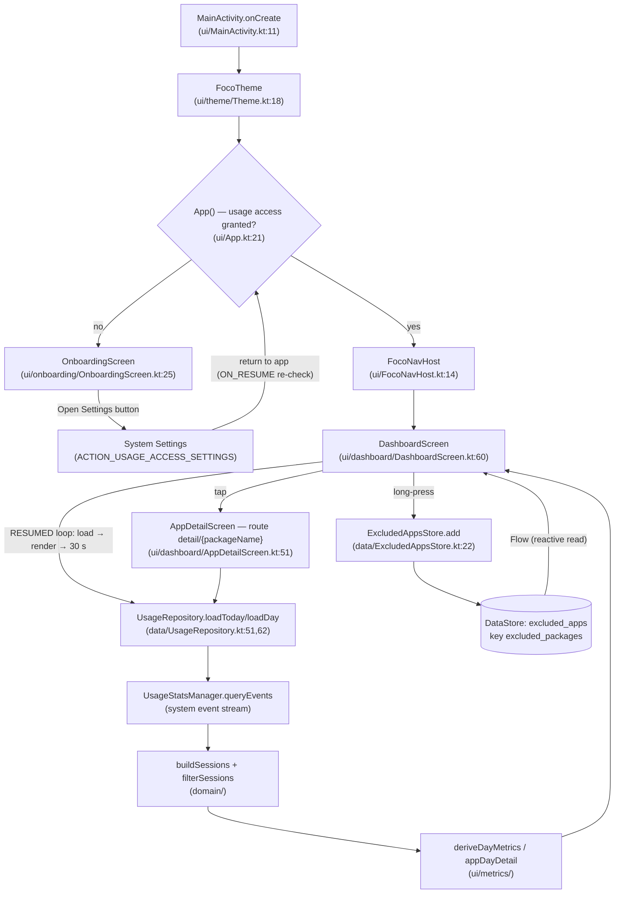

# Mechanism note — How the UI works (screens, navigation, data flow)

> Anchored by `/spec-explain` · 2026-10-16. This is documentation of the mechanism;
> the contract lives in `openspec/specs/` (`usage-tracking`, `code-structure`).
> Code is the authority — refs below are `file:line` at the time of writing.

## Mechanism

1. **Entry.** `MainActivity.onCreate` (`app/src/main/java/com/foco/app/MainActivity.kt:11`) enables
   edge-to-edge and sets the Compose content: `FocoTheme { App() }` (lines 13–17). There is one
   Activity for the whole app.
2. **Theme.** `FocoTheme` (`ui/theme/Theme.kt:18`) picks a Material 3 color scheme: dynamic
   (wallpaper-based) on Android 12+, default schemes below; dark follows the system setting.
3. **Permission gate.** `App()` (`ui/App.kt:21`) checks `UsageAccess.isGranted(context)`
   (`data/UsageAccess.kt:18` — an AppOps read of `PACKAGE_USAGE_STATS`) and **re-checks on every
   `ON_RESUME`** via a `DisposableEffect` (lines 26–34). Granted → `FocoNavHost()`; not granted →
   `OnboardingScreen()`. The onboarding button opens the exact system screen
   (`Settings.ACTION_USAGE_ACCESS_SETTINGS`, `ui/onboarding/OnboardingScreen.kt:51`); when the user
   comes back, the resume re-check flips the gate — no in-app dialog exists for this permission.
4. **Navigation.** `FocoNavHost` (`ui/FocoNavHost.kt:14`) declares two routes with
   navigation-compose: `dashboard` (start) and `detail/{packageName}` (lines 17–31). Tapping an app
   row navigates to `detail/<package>`; the package name travels as a route argument.
5. **Dashboard data loop.** `DashboardScreen` (`ui/dashboard/DashboardScreen.kt:60`) creates the
   `UsageRepository` once (`remember`, line 66) and runs a `repeatOnLifecycle(RESUMED)` loop
   (lines 80–87): **load → render → wait 30 s → load…**. Leaving RESUMED pauses the loop, so there
   is automatic refresh on every return and zero background work. There is no manual refresh
   control anywhere.
6. **Load.** `UsageRepository.loadToday/loadDay` (`data/UsageRepository.kt:51,62`) queries
   `UsageStatsManager.queryEvents(startOfDay, min(dayEnd, now))`, maps
   `ACTIVITY_RESUMED/PAUSED/STOPPED` to plain `UsageEvent`s (lines 70–84), folds them into sessions
   (`domain/SessionBuilder.kt:15`) and applies the package policy (`domain/SessionFilter.kt:6` —
   launcher apps only, minus our own app and the current home app, lines 29–48).
7. **Derivation in the UI layer.** `deriveDayMetrics` (`ui/metrics/UsageMetrics.kt:51`) computes the
   day total, the ranking and the hourly buckets — all pure functions, memoized with
   `remember(sessions, excludedPackages)` (`ui/dashboard/DashboardScreen.kt:108`). Excluded
   packages affect **only the ranking**; their time still counts in total and hours
   (`UsageMetrics.kt:17–32`). Sessions crossing an hour boundary are split in `hourlyDistribution`
   (lines 35–48).
8. **Rendering.** Header “Hoy” + “Uso en pantalla: <duration>” (lines 122–126); `HourChart`
   (24 bars, `ui/dashboard/HourChart.kt:24`); ranking list of `AppUsageRow` — icon via `AppIcon`
   and name via `appLabel`, both resolved from `PackageManager` **off the main thread**
   (`AppIcon.kt:25`, `AppLabel.kt:12`), with graceful fallbacks (gray box / package name).
   Loading spinner and an explicit empty state (“Sin actividad registrada…”).
9. **Interactions.** Tap → navigate to detail (line 172). Long-press → `ExcludedAppsStore.add` +
   snackbar with “Deshacer” (Undo); pressing the action removes the exclusion (lines 94–105). The
   exclusion set arrives as a `Flow` collected in a `LaunchedEffect` (lines 90–92), persisted in
   DataStore Preferences (`data/ExcludedAppsStore.kt:10,15` — store `excluded_apps`, key
   `excluded_packages`).
10. **Detail.** `AppDetailScreen` (`ui/dashboard/AppDetailScreen.kt:51`) loads the selected day
    (`loadDay`, line 63) and derives `appDayDetail` (`ui/metrics/AppDetail.kt:13`) — total,
    session count, first/last, average, longest, hourly distribution and the session list. The
    ‹ › selector walks `availableDays` (today + 6 previous, `data/AvailableDays.kt:9`) and disables
    at the edges. Back is a visible button that calls the `OnBackPressedDispatcher`
    (line 80); the system back gesture/button returns too.

## Physical traceability

- **Code**: every hop above is `file:line`; no hidden layers, no dependency injection, no
  ViewModels — plain Compose state (`remember` + effects).
- **Persisted state (the only one)**: `excluded_apps.preferences_pb` — a DataStore Preferences file
  in the app's private storage (`files/datastore/` under the app data dir). Lifecycle: created on
  the first exclusion; updated by `add`/`remove`; survives process death and reboots; deleted only
  when the user clears app data or uninstalls the app.
- **Read-only, system-owned**: usage events (`UsageStatsManager`) — our app never writes there.
- **Outside the app**: the Settings screen where the user grants usage access; on return the gate
  re-checks (step 3).
- **No network, no accounts, no other files.**

## Limits and failure modes

- **Access revoked**: the gate flips back to onboarding on the next resume (`App.kt:28`).
- **System retention**: `queryEvents` only serves recent history; the day selector is bounded by
  design (7 days, `AvailableDays.kt:9`). A day inside the window with no data shows the explicit
  empty state.
- **Fresh device / no data yet**: dashboard shows “Sin actividad registrada todavía hoy.”
- **App uninstalled**: icon/label resolution falls back safely (`runCatching` in `AppIcon.kt:29`,
  `AppLabel.kt:16`).
- **Process death**: nothing to restore — state is rebuilt from the system source; the detail’s
  selected day resets to today.
- **Concurrency**: single process; DataStore serializes edits; the refresh loop only exists while
  RESUMED (no background timers).
- **Timezone**: day boundaries use the device’s current zone (`ZoneId.systemDefault()`), so a zone
  change moves “today” accordingly.

## Touched APIs

- `ComponentActivity` / `setContent` / `enableEdgeToEdge` (androidx.activity) — the single Activity
  hosting the Compose tree; edge-to-edge draws under the system bars.
- Compose runtime (`remember`, `mutableStateOf`, `LaunchedEffect`, `produceState`) — UI as a
  function of state; effects bridge to coroutines.
- `repeatOnLifecycle` (androidx.lifecycle) — restarts the load loop only while RESUMED (refresh on
  return, no background work).
- `NavHost` / `rememberNavController` (androidx.navigation.compose) — two routes; the package name
  is a route argument.
- `UsageStatsManager.queryEvents` (android.app.usage) — the system’s event stream; the only data
  source.
- `AppOpsManager.unsafeCheckOpNoThrow` (android.app) — reads the special `GET_USAGE_STATS` app-op
  (this permission has no runtime dialog).
- `Settings.ACTION_USAGE_ACCESS_SETTINGS` (android.provider) — opens the exact Settings screen for
  the toggle.
- `PackageManager.getApplicationIcon` / `getApplicationLabel` / `queryIntentActivities`
  (android.content.pm) — icon, visible name and the launcher-apps filter; off the main thread.
- DataStore Preferences (`preferencesDataStore`) — atomic, coroutine-friendly persistence for the
  exclusion list.
- Material 3 (`Scaffold`, `SnackbarHost`, dynamic color schemes) — theme and feedback.

## Data path

## Spec coverage

- `usage-tracking` covers: session source and filtering (reqs 1–2), derived metrics (3), refresh on
  return and every 30 s with none in background (4–5), no manual control (6), tap-to-detail and
  back (7, 14), hourly breakdown / day summary / day selector (8–10), exclusions with Undo and
  persistence (11–13).
- `code-structure` covers the layer layout, one-type-per-file and purity this explanation relies on.
- **Not yet spec’d, already in flight**: the permission gate UI → `app-entry-gate` draft; theme /
  appearance control → `app-settings` draft (today the theme follows the system).
- No refactor proposals from this pass: the flow is linear, explicit and matches the specs.
